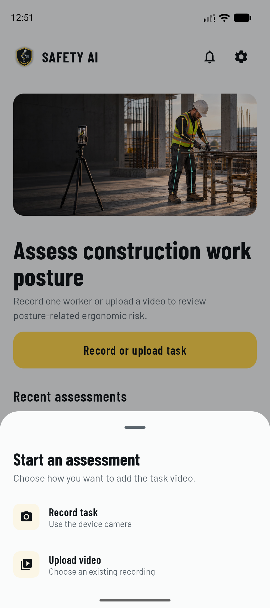
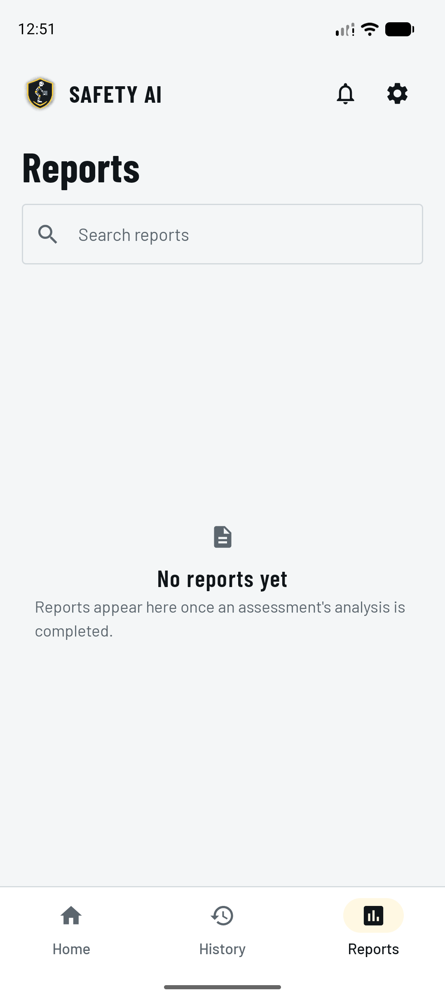

# Safety AI

Android application for ergonomic risk assessment of construction tasks. A worker's task is recorded with the camera (or imported as a video), analysed **entirely on the device**, and scored with the REBA (Rapid Entire Body Assessment) method. Results are stored locally and can be reviewed per assessment or exported as a PDF report.

> Status: research prototype. Not a certified safety or medical tool.
> Copyright (c) TasvirLab. All rights reserved. No license is granted.

## Screenshots

Captured on an Android emulator with no analysis data.

| Home | New assessment | History |
|:---:|:---:|:---:|
|  |  |  |
| **Reports** | **Settings** | **Home (dark)** |
|  |  |  |

## Analysis pipeline

```
video → frame sampling → person detection (YOLOX) → 2D pose (RTMPose, 21 canonical joints)
      → 3D lifting (PoseMamba) → joint angles → REBA Tables A/B/C
      → Activity Layer (static / repetition / rapid motion) → conditional final REBA score
```

| Stage | Implementation |
|---|---|
| Detection and 2D pose | YOLOX-m and RTMW-x (RTMPose) ONNX models run through ONNX Runtime (`analysis/Rtm*`) |
| 3D lifting | PoseMamba ONNX model plus a native C++ selective-scan operator (`posemamba_deployment/`) |
| REBA scoring | Kotlin implementation of angles and Tables A/B/C (`analysis/RebaAngles.kt`, `RebaScorer.kt`) |
| Activity Layer | Static posture, repetition and rapid-motion detection (`analysis/ResearchActivityLayer.java`) |
| Orchestration | `OnDeviceSafetyAnalysisEngine`, configured by `FrozenPipeline` (pinned parameters and run provenance) |

The `backend/` folder holds the Python reference pipeline that the Android implementation is checked against (golden data, parity scripts). It is not required to build or run the app.

## Features

Implemented:
- Guided new-assessment flow: job details, load and coupling, source selection, review.
- Camera recording (CameraX) with live framing guidance, or video import.
- On-device pose estimation, 3D lifting and REBA scoring with per-frame timeline.
- Assessment history, detail and edit screens, backed by Room (schema is versioned in `app/schemas`).
- Report viewer with REBA timeline chart, 3D pose viewer and video overlay of 2D joints (Media3).
- PDF report generation and case-study export.
- Light and dark theme, settings and FAQ screens.

In progress / known limitations:
- Analysis time depends heavily on the device; parallel-session settings were tuned on a single flagship phone.
- The 3D lifting depends on a custom native operator that is built only for `arm64-v8a` and `x86_64`.
- `RapidMotionTimeline` exists but is not yet wired into a screen.
- The notifications screen is minimal.
- Instrumented tests need a device, the model files and local test videos (see below).
- Validation against larger participant datasets is ongoing and not part of this repository.

## Tech stack

Kotlin, Jetpack Compose (Material 3), Navigation Compose, Room + KSP, DataStore, CameraX, Media3 ExoPlayer, ONNX Runtime Android 1.22, C++/CMake (NDK) for the PoseMamba scan operator. Gradle with a version catalog (`gradle/libs.versions.toml`); AGP 9.4, Kotlin 2.2, `minSdk` 24, `compileSdk` 37.

## Repository layout

```
app/                         Android application (UI, data, analysis, reports)
posemamba_deployment/        Native PoseMamba selective-scan library (:posemamba-scan Gradle module)
selective_scan_ndk/          Operator specification, C++ sources and fixture tooling
backend/                     Python reference pipeline, vendored RTMPose helpers, parity scripts
design_handoff/ (local only) Design prototypes, not versioned
```

Inside `app/src/main/java/com/azizbek/safetyai`: `analysis` (pose, REBA, pipeline), `assessment` (form flow), `capture` (camera), `data` (Room, repositories, video storage), `detail`, `history`, `reports`, `settings`, `navigation`, `ui`.

## Model files (not included)

Large ONNX models are not stored in Git. Place them manually before building the app that bundles them.

| Model | Location | SHA-256 |
|---|---|---|
| YOLOX-m detector `yolox_m_8xb8-300e_humanart-c2c7a14a.onnx` | `app/src/main/assets/models/rtmpose/` | `3dea6513388889f0fff4b77bf7a26013600321b9eb9ceb0e9a400a82572f5f23` |
| RTMW-x pose `rtmw-dw-x-l_simcc-cocktail14_270e-256x192_20231122.onnx` | `app/src/main/assets/models/rtmpose/` | `9a9bc17c13ff0a1e37507f45a037a21bc410cd08374b0e664c57d0080843aa58` |
| PoseMamba lifter `posemamba.onnx` | `posemamba_deployment/android/posemamba-scan/src/main/assets/model/` | verified by `PoseMambaModelLoader` |

The RTMPose files come from MMPose / RTMPose model zoo releases. The app checks the SHA-256 of both RTMPose files when preparing them and refuses to run on a mismatch. The PoseMamba model is exported from the project's PoseMamba checkpoint.

## Build and run

Requirements: Android Studio with JDK 17+, Android SDK 37, an NDK and CMake 3.22.1, and the ONNX Runtime 1.22.x C++ headers.

1. Add these to `~/.gradle/gradle.properties` (not to the repository):
   ```
   SCAN_ORT_INCLUDE=<absolute path to the ONNX Runtime headers directory>
   SCAN_NDK_VERSION=<installed NDK version>
   ```
2. Copy the model files into the locations listed above.
3. Build and test:
   ```
   ./gradlew assembleDebug testDebugUnitTest lintDebug
   ```
4. Install on a device with `./gradlew installDebug`. Use an arm64 device; analysis is compute heavy.

### Instrumented tests

`./gradlew connectedDebugAndroidTest` needs a physical device, the model files, and short test videos in `app/src/androidTest/assets/video/` (`decoder_30_rotated.mp4`, `decoder_60.mp4`, `real_lifting_*.mp4`). Videos, participant recordings, and research-derived golden fixtures (`rtmpose_golden/`, `reba/` under `app/src/androidTest/assets/`) are deliberately excluded from the repository; the tests that depend on them cannot run from a clean checkout.

## Data and privacy

Videos and results are stored in app-private storage on the device; nothing is uploaded. Participant recordings, research datasets, run outputs, and model binaries are excluded through `.gitignore`.
