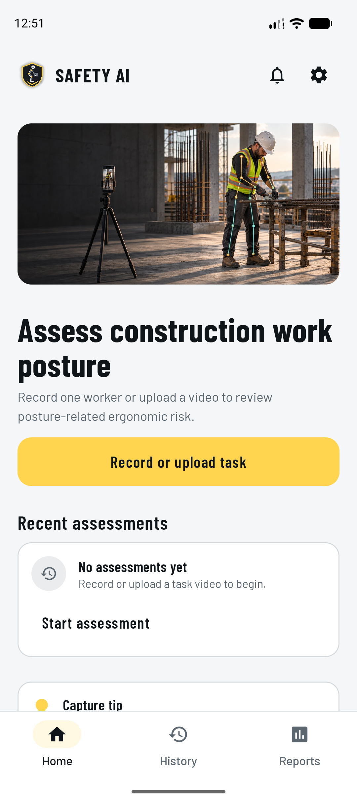
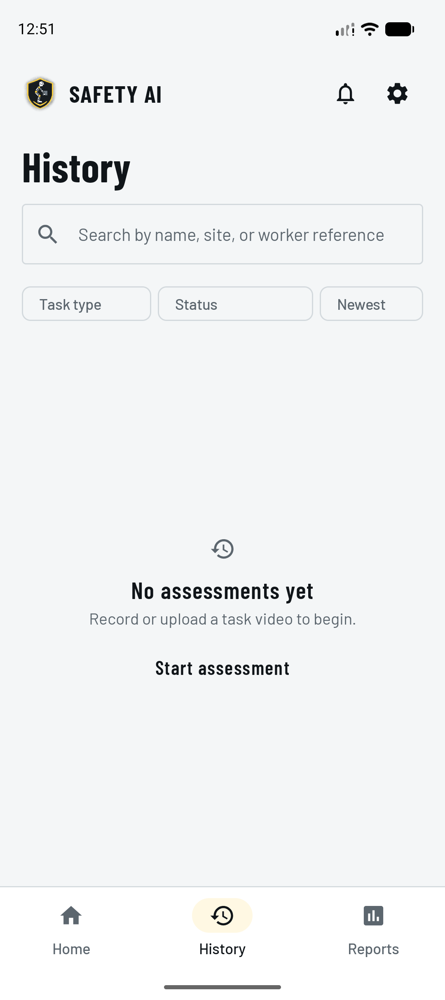
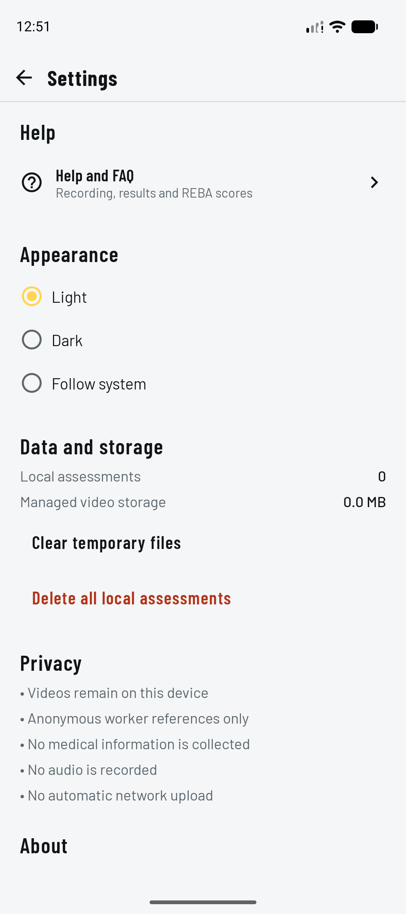
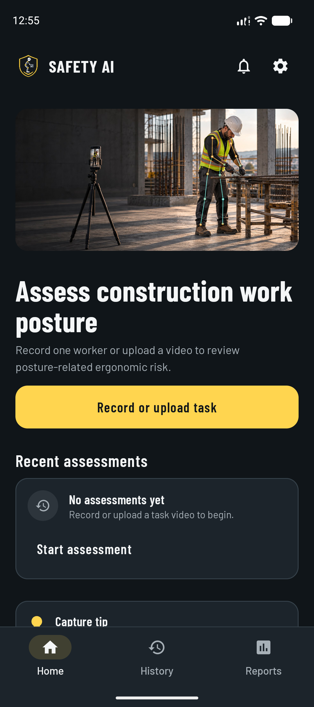

# Safety AI

On-device ergonomic risk assessment for construction tasks. Record or import a video of a worker, and the app estimates 2D and 3D body pose, computes REBA scores over time, detects static, repetitive and rapid movement, and produces a report. Everything runs on the phone. No video leaves the device.

> Research prototype. Not a certified safety, medical or clinical tool, and not a replacement for a qualified ergonomist.
> Copyright (c) TasvirLab. All rights reserved. No license is granted.

<!-- TODO(owner): replace with analysis screenshots, see docs/CAPTURE.md -->
| Home | New assessment | History |
|:---:|:---:|:---:|
|  |  |  |
| **Reports** | **Settings** | **Home (dark)** |
|  |  |  |

These screenshots were taken on an emulator without analysis data.

## Overview

Safety AI is a research prototype I built end to end: the Android app, the on-device inference pipeline, the native operator and the Python reference used to check it.

Manual ergonomic assessment of construction work is slow and depends on the observer. Safety AI automates the measurement part: it turns a single-camera video into joint angles and REBA scores, so a person reviewing the task can see which moments and body regions carry the most risk.

## Core features

- Guided assessment intake: task type, load, sudden force, coupling.
- CameraX recording with live framing guidance, or video import.
- Per-frame REBA scores with a timeline chart, 3D pose viewer and 2D joint overlay on the video.
- Static posture, repetition and rapid-motion findings.
- Local assessment history (Room), edit, delete, and PDF report export.
- Light and dark themes.

## How it works

```mermaid
flowchart LR
    V[Video] --> D[Frame decoding]
    D --> Y[YOLOX person detection]
    Y --> R[RTMPose 2D keypoints]
    R --> C[Canonical 21-joint skeleton]
    C --> P[PoseMamba 3D lifting]
    P --> A[Anatomical angles]
    A --> S[REBA Tables A, B, C]
    S --> L[Activity layer: static, repetition, rapid motion]
    L --> F[Final REBA and report]
```



The pipeline is configured and pinned in `analysis/FrozenPipeline.kt`, which also records model hashes and settings as run provenance. The Python code in `backend/` is a reference implementation used to check the Android output. The app does not need it.

## Engineering highlights

YOLOX (detection), RTMPose / RTMW (2D pose), PoseMamba (3D lifting) and the REBA method are existing work by others. This repository contains the integration and the system around them.

- **Fully on-device inference.** ONNX Runtime on Android runs the detector, the 2D pose model and the 3D lifter. The RTMPose model files are verified by SHA-256 before use.
- **Native selective-scan operator.** PoseMamba depends on a Mamba selective scan that ONNX Runtime does not provide. `selective_scan_ndk/` and `posemamba_deployment/` implement it in C++ as a custom operator, built with CMake for `arm64-v8a` and `x86_64`.
- **Canonical 21-joint skeleton.** The 133-keypoint RTMW output is mapped to the joint set and ordering the 3D model was trained on, with gap repair, geometry quality checks and temporal resampling in front of the lifter.
- **REBA in Kotlin.** Joint angle definitions and Tables A, B and C are implemented in `RebaAngles.kt` and `RebaScorer.kt`. The activity layer (static hold, repetition, rapid motion) is a research-specific conditional extension of REBA and is kept separate from the published method.
- **Parity with a reference.** The Python pipeline in `backend/` and golden data are used to compare Android against the reference implementation.
- **Local data handling.** Videos, results and the database are app-private, excluded from Android backup and device transfer, and deleted together with their assessment. Results are invalidated when an input that affects the analysis changes, and result files are replaced atomically.
- **App.** Kotlin, Jetpack Compose, CameraX, Media3, Room, and a PDF report generator.

## Technology stack

Kotlin 2.2, Jetpack Compose (Material 3), Navigation Compose, Room with KSP, DataStore, CameraX, Media3, ONNX Runtime Android 1.22, C++ with the NDK and CMake. Python with NumPy and PyTorch for the reference pipeline. Gradle 9.6, AGP 9.4, `minSdk` 24, `compileSdk` 37.

## Repository structure

```
app/                     Android app: analysis, capture, data, history, reports, UI
posemamba_deployment/    Gradle module :posemamba-scan (native operator and lifter loader)
selective_scan_ndk/      Operator specification, C++ sources, fixture tooling
backend/                 Python reference pipeline and vendored RTMPose helpers
scripts/check_setup.py   Verifies a checkout has what the build needs
docs/                    Screenshots and capture checklist
```

## Getting started

Requirements: JDK 17 or newer, Android SDK, NDK `28.0.13004108`, CMake `3.22.1`, and the ONNX Runtime 1.22 C++ headers (found in the `onnxruntime-android` AAR under `headers/`).

1. Add to `~/.gradle/gradle.properties`:
   ```
   SCAN_ORT_INCLUDE=<absolute path to the ONNX Runtime headers>
   SCAN_NDK_VERSION=28.0.13004108
   ```
2. Check the setup: `python scripts/check_setup.py`
3. Build: `./gradlew assembleDebug`

A clean checkout without any model files builds, passes the unit tests and passes lint (verified in GitHub Actions). Without the models, analysis cannot run. To run analysis, place the models below. They are not distributed with this repository.

| Model | Location | SHA-256 |
|---|---|---|
| YOLOX-m `yolox_m_8xb8-300e_humanart-c2c7a14a.onnx` | `app/src/main/assets/models/rtmpose/` | `3dea6513388889f0fff4b77bf7a26013600321b9eb9ceb0e9a400a82572f5f23` |
| RTMW-x `rtmw-dw-x-l_simcc-cocktail14_270e-256x192_20231122.onnx` | `app/src/main/assets/models/rtmpose/` | `9a9bc17c13ff0a1e37507f45a037a21bc410cd08374b0e664c57d0080843aa58` |
| PoseMamba `posemamba.onnx` | `posemamba_deployment/android/posemamba-scan/src/main/assets/model/` | `9313221f443d5f1f8b3169ef828e73da804d04b46941d629e8934671262d8c16` |

The RTMPose files come from the MMPose model zoo. The PoseMamba file is exported from the project's own checkpoint.

## Testing

```
./gradlew testDebugUnitTest lintDebug
```

Unit tests need no model or video. They cover the REBA and temporal logic, the frozen pipeline configuration, result storage (round trip, atomic replacement, corrupted files, orphan cleanup) and the rules that decide when a result becomes stale.

GitHub Actions (`.github/workflows/ci.yml`) runs on every push: Gradle wrapper validation, native build, `assembleDebug`, unit tests and lint, with no private assets.

Not run in CI, because they need private material:

- Instrumented tests (`connectedDebugAndroidTest`): a device, the models, and private test videos and golden files that are excluded from the repository.
- Python reference tests (`backend/tests`): PyTorch, the research data root (`SAFETYAI_RESEARCH_DATA_ROOT`) and the research checkpoint.

## Known limitations

- Research prototype. Risk labels follow REBA and the research activity rules. They are not clinical results.
- Inference speed was measured and tuned on a single flagship phone. The pipeline records a device-specific parallelism profile, and other devices fall back to sequential CPU execution. No real-time performance is claimed.
- Single camera, single worker. Accuracy depends on framing, occlusion and lighting.
- No validation results are published in this repository.
- `RapidMotionTimeline` is not connected to a screen. The notification screen is minimal.
- Instrumented and parity tests cannot be reproduced without the private assets.

## Privacy and third-party material

Recordings and results stay in app-private storage and are excluded from backup and device transfer. PDF export is user-initiated. See `THIRD_PARTY_NOTICES.md` for model, library and font attributions and `CHANGELOG.md` for changes.

## Developer

Azizbek Kakhkharov ([@tasvirlab](https://github.com/tasvirlab)). Copyright (c) TasvirLab. All rights reserved.
